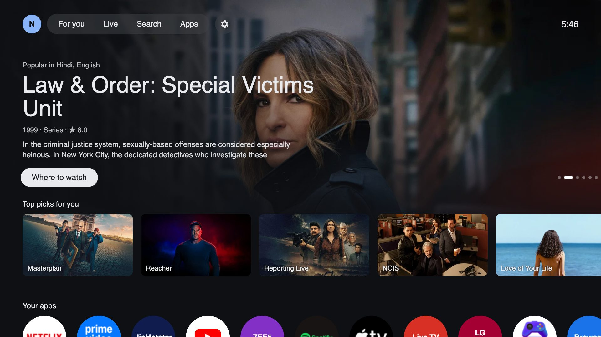
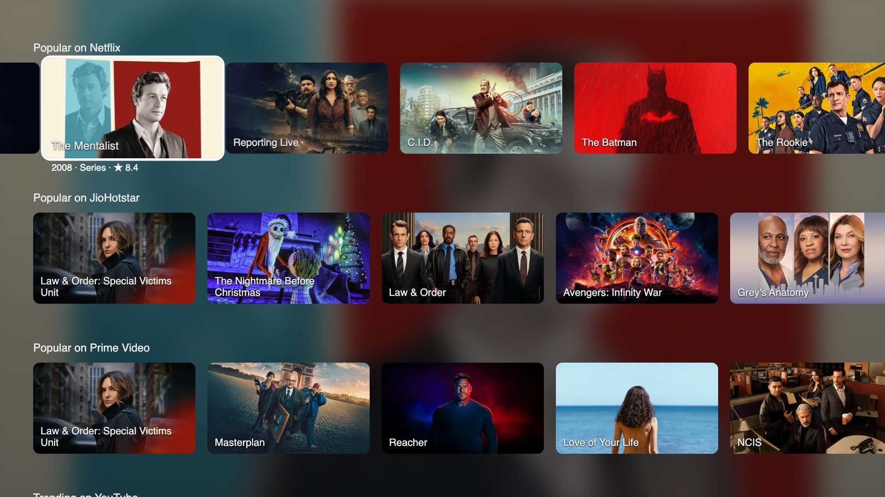
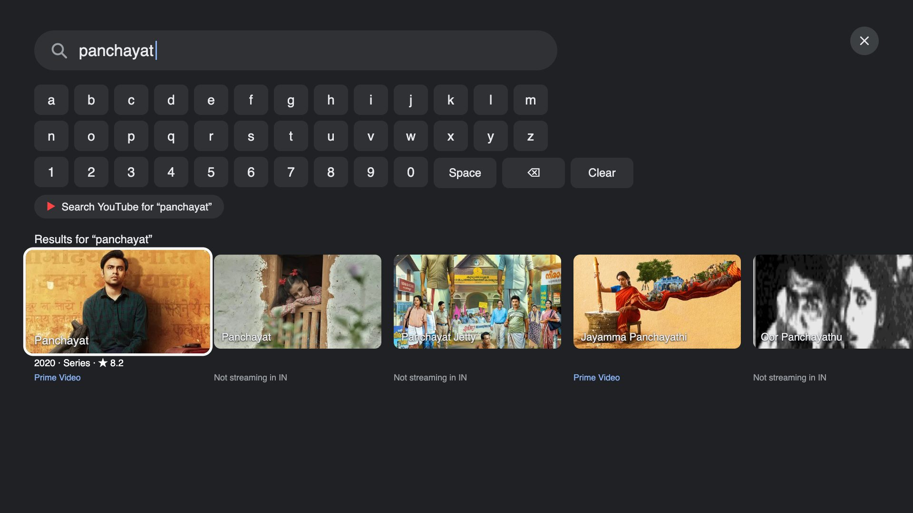
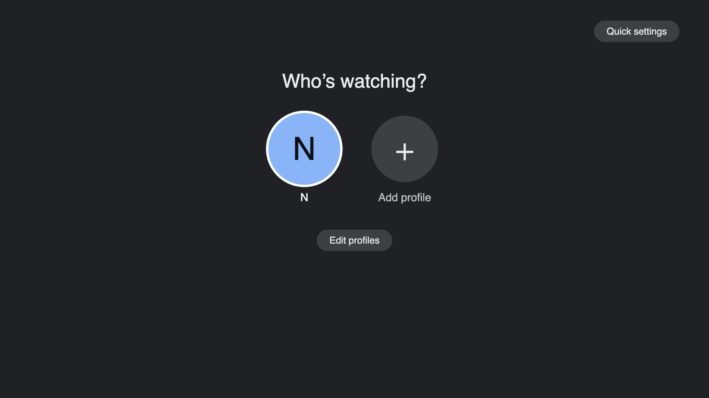

# TheBoringTV for LG webOS

A Google TV-style home screen for LG webOS TVs. It's a plain HTML/CSS/JS web app with no build step.

Built and tested on an LG 55UR8040 (webOS 25, SDK 10.3, Chromium 120) at 1920x1080. Works with the arrow keys,
OK and Back, the Magic Remote pointer, and the scroll wheel.



| Rows with a blurred background | Details page with where to watch |
|:---:|:---:|
|  |  |
| **Search across services** | **Quick settings** |
|  |  |
| **Settings** | **Profiles** |
|  |  |
| **Ambient mode** | |
|  | |

## Features
- **Hero and rows:** full-screen featured titles, "Top picks", "Popular on Netflix / JioHotstar / Prime Video" and
  "Trending on YouTube", using [TMDB](https://www.themoviedb.org/) and the YouTube Data API.
- **Where to watch:** pressing OK on a title opens a details page with "Watch on …" buttons for the services that
  stream it in your country, a trailer, cast and "More like this".
- **Watchlist, Continue watching:** both saved on the TV. Netflix and Hotstar don't share watch history, so
  Continue watching lists the titles you opened from this home screen.
- **Search across services:** an on-screen keyboard; each result shows where it's streaming.
- **Your apps:** checks a list of known apps (webOS won't list installed apps to non-system apps) and opens them.
- **Settings:** country, recommendation languages (pick several), which services get rows, clock, and more.
- **Quick settings panel:** Wi-Fi, audio output, Bluetooth, volume, screensaver and inputs.
- **Profiles:** each has its own settings, watchlist and history, plus a kids profile.
- **Ambient mode:** a slideshow of artwork with the clock when the TV is idle.

## Setup
1. Copy `keys.example.js` to `keys.js` and add a free TMDB API key and a YouTube Data API v3 key.
   `keys.js` is gitignored.
2. Set your region, services and apps in `config.js`.
3. Preview it in a browser:
   ```bash
   python3 -m http.server 8765
   ```
   Then open http://localhost:8765 in a 1920x1080 window. Use the arrow keys, Enter, and Esc (Esc acts as Back).

## Install on the TV
Turn on LG's Developer Mode (or use a rooted TV), install the [webOS CLI](https://www.npmjs.com/package/@webos-tools/cli),
and add your TV with `ares-setup-device`. Then:
```bash
ares-package . -o /tmp --no-minify
```
```bash
ares-install --device tv /tmp/com.boring.tvhome_*.ipk
```
```bash
ares-launch --device tv com.boring.tvhome
```
Developer Mode installs expire after 50 hours unless you extend them in the Developer Mode app.

## Make it the real home screen (rooted TVs)
On a TV rooted with the [Homebrew Channel](https://github.com/webosbrew/webos-homebrew-channel), there are two options.
To root a TV, see [e.nya.je/getroot](https://e.nya.je/getroot/) (at your own risk: it may void your warranty, and a firmware update can remove root).
Both live in `service/`, are packaged with the app, and change no files on disk.

**Replace LG's home (recommended).** `service/as-home.sh` runs early at every boot. It copies TV Home into RAM, gives
the copy LG home's app id (`com.webos.app.home`), bind-mounts it over LG's home, and restarts the app manager so it
picks the copy up. webOS then opens TV Home wherever it would open LG's home: the Home button, Back from an app, and
startup (the script also opens it at boot, so the TV no longer starts on the Live TV no-signal screen).
```bash
ares-package . service -e service -e docs -e .git -o /tmp --no-minify
```
```bash
ares-install --device tvroot /tmp/com.boring.tvhome_*.ipk
```
```bash
ssh root@<tv-ip> 'ln -sf /media/developer/apps/usr/palm/services/com.boring.tvhome.service/as-home.sh /var/lib/webosbrew/init.d/40-tvhome-as-home && reboot'
```
It also sets the TV's "last input" to TV Home, so boots that would open Live TV ("Not Programmed" without an antenna)
open TV Home's loading screen instead (the original value is saved in `/var/lib/webosbrew/tvhome-last-input.orig`).
It also turns off LG's *Home Auto Launch*, so a power cut behaves like a restart: a black screen, then TV Home's
loading screen, and LG's own home never shows. The trade-off is that webOS's boot animation no longer plays (it only
runs on the Home Auto Launch path, which would otherwise open LG's home before the swap).

Undo: `rm /var/lib/webosbrew/init.d/40-tvhome-as-home`, set the last input back to Live TV with
`luna-send -n 1 luna://com.webos.settingsservice/setSystemSettings '{"category":"general","settings":{"lastInputApp":"com.webos.app.livetv","physicalLastInputApp":"com.webos.app.livetv","homeAutoLaunch":"on"}}'`,
and restart the TV. The script also hides the regular TV Home
app from the app list (another RAM-only mount), so before installing an update run
`ssh root@<tv-ip> 'umount /media/developer/apps/usr/palm/applications/com.boring.tvhome/appinfo.json'`.

After a power cut, webOS shows the last input for the first ~50 seconds until the script can run; with the setting
above that's TV Home's loading screen. Turning the TV on with the remote doesn't do a cold boot
when Quick Start+ is on (Settings → General → Devices → TV Management), so it comes straight back to TV Home. The running copy is TV Home as it was
at the last boot, so restart after updating TV Home. TV Home running as the home app keeps its own settings and
history, separate from the regular TV Home app.

**Or watch the Home key.** `service/service.js` reads the remote without grabbing it and opens TV Home after each Home
press, at startup and after standby. LG's home still flashes briefly and Back from apps still goes to LG's home.
```bash
ssh root@<tv-ip> 'D=/media/developer/apps/usr/palm/services/com.boring.tvhome.service; ln -sf $D/autostart.sh /var/lib/webosbrew/init.d/50-tvhome && sh $D/autostart.sh'
```
Use one option, not both. `HOME_CODE` in `service/service.js` is 773 on LG Magic Remotes; raise `HOME_DELAYS` if
LG's home still covers TV Home.

## Rooted extras: real apps, picture and sound, inputs, remote control
With the service running (rooted TV), it also gives TV Home what a normal app can't get. It runs as root and
calls a fixed list of system methods, which the page reaches over the TV's loopback (`127.0.0.1:45620`):
- **Your apps** shows every installed app with its real icon, not the list in `config.js`.
- **Quick settings** gets picture mode, sound mode, brightness, a row of inputs (HDMI names, connected ones
  first) and **Screen off**, which keeps audio playing; any remote key turns the screen back on.

`tools/tv` controls the TV from your computer over SSH:
```bash
export TV_IP=192.168.1.50 TV_MAC=aa:bb:cc:dd:ee:ff   # your TV; the MAC is only needed for "on"
tools/tv volume 20        # or up, down, mute, unmute
tools/tv input hdmi1
tools/tv launch netflix   # tools/tv apps lists ids
tools/tv picture cinema   # backlight 0-100, sound movie, screen-off, home, off, on, status
```
For Home Assistant, its built-in **LG webOS Smart TV** integration already controls power, volume, inputs and apps
over the TV's own network API, with no root needed. Use `tools/tv` (from a shell command) for the extras.

## Deep links
"Watch on …" opens the exact title, using the link format each app accepts (Prime's and JioHotstar's were captured
from LG's own voice search):

| Service | Id source | Link sent as `contentTarget` |
|---|---|---|
| Netflix | Wikidata (P1874) | `m=https://www.netflix.com/title/<id>&source_type=4` |
| Prime Video | Prime's search page, via the service (rooted TV) | the Amazon title id, `amzn1.dv.gti.…` |
| JioHotstar | JustWatch, matched by TMDB id, then Wikidata (P11049) | `https://livingroom.hotstar.com/<id>` |
| YouTube | the video id | `https://www.youtube.com/tv?v=<id>` |

Ids are cached on the TV. If a lookup finds nothing or takes too long, the app just opens normally.

## Limits
- Without root it's an app, not the system launcher: the Home button opens LG's home.
- webOS still shows a short splash (TV Home's own dark one) when it has to start TV Home from scratch.
- Deep links need each service's own title id, so a title opens the app's home when no id is found.
- The app can't read LG Channels' channel list or Netflix/Hotstar watch history.

## Credits
App icons in `icons/`, the webOS launch approach and the Home-button service in `service/` come from
[zzeppieri/webos-custom-home](https://github.com/zzeppieri/webos-custom-home) (MIT licence). Title data and images
come from TMDB; this product uses the TMDB API but is not endorsed or certified by TMDB.

## Feature files
Each feature lives in `features/<name>.js` + `features/<name>.css` and only talks to the core through `window.TV`
(defined at the end of `app.js`). `profiles.js` loads *before* `app.js`; the others load after it.

| API | What it does |
|---|---|
| `TV.addView(name, {nav, show, hide, onFocus?, back?, keydown?})` | Full-screen/overlay screen. `nav()` returns rows of focusable elements (give them class `f`; focused one gets `.focus`). Arrow keys, OK, pointer and wheel then work automatically. `back()` overrides Back (default: `TV.closeView()`). `keydown(ev)` runs first on every key while the view is open; return `true` to swallow it. |
| `TV.openView(name, arg)` / `TV.closeView()` | Push / pop a view; closing restores the previous focus. |
| `TV.rebuild(r?, c?)` | Re-read `nav()` after the view's content changes (optionally move focus). |
| `TV.addTab(label, viewName)` | Adds a top-bar tab that opens a view. |
| `TV.addRow(fn)` + `TV.refresh()` | `fn()` returns `{title, items}` or `null`; shown after Continue watching. |
| `TV.itemOk = fn(item)` | Called on OK for any title card / hero. Default `TV.openItem(item)` (open the service). |
| `TV.onAvatar = fn()` | What the avatar does (default: quick settings panel). |
| `TV.addSetting(row, default)` | Adds a row to the Settings panel: `{key, title, hint?, many?, opts: [[value, label]…]}`. Value lands in `TV.S[key]`. |
| `TV.tmdb(path, q)`, `TV.get(url)`, `TV.fromTmdb(m, svc?)`, `TV.svcFor(providerName)` | Data helpers. Items look like `{title, sub, meta, img, bg, blur, src, svc, tmdb: {type, id}}`. |
| `TV.launch(appId, params)`, `TV.luna(uri, params)`, `TV.toast(msg)`, `TV.card(item)`, `TV.el`, `TV.esc` | UI / system helpers. |
| `TV.store(key[, value])` | Per-profile JSON storage. |
| `TV.heroItems()`, `TV.view()`, `TV.idleSince()`, `TV.setBg(url)`, `TV.S`, `TV.C`, `TV.LANGS`, `TV.IMG` | State. |
| `window.TV_PROFILE = {prefix, name, color, extraQ, hideApps}` | Set by `profiles.js` before `app.js` runs: storage prefix, avatar, extra TMDB discover query (e.g. kids certification), app ids to hide. |
| `tvready` event on `window` | Fired once `window.TV` exists (for `profiles.js`, which loads first). |
